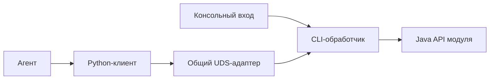

# Общий командный вход и локальный UDS

Статус: согласованное направление, реализация отложена. Задача с приоритетом
LOW находится в [бэклоге проекта](../BACKLOG.md#next). Сейчас UDS-входа нет;
этот документ не описывает уже доступные команды или работающий сервер.

## Границы ответственности

- **Java API модуля** выполняет бизнес-операции и возвращает результат.
  Работа с терминалом и сокетами находится снаружи этого API.
- **CLI-обработчик модуля** единолично разбирает его текстовые команды,
  преобразует аргументы в вызовы Java API и возвращает ответ вызывающему.
- **Консольный вход** получает команду, вызывает CLI-обработчик и печатает ответ.
- **Общий UDS-адаптер** получает сообщение, целиком передаёт тому же обработчику
  и возвращает ответ через соединение клиента. Он знает только вызываемый
  обработчик, а не названия команд, модулей или бизнес-операций.

Общий CLI проекта сохраняет маршрутизацию в CLI модулей. Повторять разбор
аргументов каждого модуля в общем CLI или в UDS-адаптере не требуется.
Существующие входы описаны в [Driver API](../Driver/api/README.md).

Транспортная часть предназначена для Tools и переиспользуется модулями.
Обработчики команд и бизнес-API остаются у потребителей; Tools не зависит
от Applier, GUI или других обслуживаемых модулей. Дополнительный оркестратор
для такого подключения не нужен.

## Ответы и вывод процесса

CLI-обработчик возвращает ответ вместо печати результата в общий `System.out`.
Консольный вход выводит его в stdout, а UDS-вход отправляет конкретному клиенту.
Логи и диагностика процесса отделены от ответа команды.
Глобальное перенаправление `System.out` на время запроса не используется.

Python-клиент соединяется с уже работающей JVM, отправляет запрос, получает
ответ и печатает его в собственный stdout. Он не создаёт новую JVM,
не инициализирует бизнес-сервисы и не содержит правил подготовки письма.
Ему известны адрес сокета и согласованный формат обмена; агенту достаточно
знать способ вызова клиента.

## Запуск и жизненный цикл

Создание API, обработчика команд и их закрытие принадлежат точке запуска
приложения. Обработчик получает готовый экземпляр API и не создаёт его заново
для каждой команды. Это разделение применимо и к одноразовому запуску.

Одноразовый `main` передаёт одну команду и завершает процесс. Долгоживущий вход
повторно вызывает тот же обработчик с тем же API. В GUI используются сервисы
работающей JVM. Цикл команд не меняет бизнес-операции и их маршрутизацию.

UDS обеспечивает обращения независимых клиентов к этой JVM. Приём и выполнение
входящего запроса не должны зависеть от потока, в котором Applier ожидает ответ
Codex: агенту может понадобиться обратный вызов писателя во время аплая.

## Канал связи

Используется Unix Domain Socket: локальное соединение по пути сокета,
без HTTP и привязки к Windows named pipes. Java 21 предоставляет стандартные
`SocketChannel` и `ServerSocketChannel` для этого канала; см.
[Java NIO](https://docs.oracle.com/en/java/javase/21/docs/api/java.base/java/nio/channels/package-summary.html).
Путь обозначает живое соединение, а не файл с командами для последующего опроса.

Кодировка и границы сообщений принадлежат транспортному слою. Точный формат
обмена, размещение адреса сокета и синтаксис Python-клиента ещё не определены.
Способ сообщить агенту о вызове — инструкция в промпте, skill или MCP-обёртка —
также не выбран. Это отдельные решения перед реализацией, а не готовые контракты.
